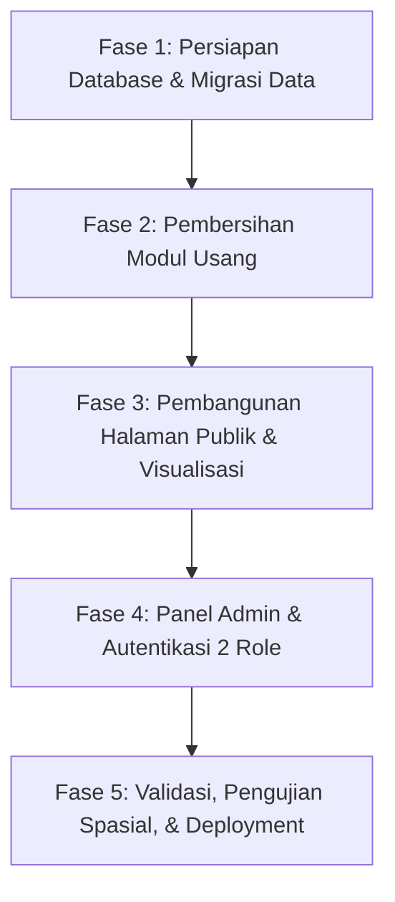

# RENCANA TRANSFORMASI SISTEM: MONITORING IRPOM
**Sistem Informasi & Pemetaan Geospasial Irigasi Perpompaan — Kabupaten Way Kanan**

---

## 1. Ringkasan Eksekutif & Visi Produk

Aplikasi ini akan ditransformasi secara menyeluruh dari sistem monitoring alsintan umum (**AlsinTrack**) menjadi platform khusus yang fokus, presisi, dan informatif: **"Monitoring IRPOM"** (Irigasi Perpompaan). 

Transformasi ini didasarkan pada dataset aktual lapangan dari file `DATA IRPOM.csv` yang memuat 127 titik unit pompa irigasi dengan cakupan layanan irigasi seluas **1.116,11 Hektar** di Kabupaten Way Kanan.

### Prinsip Utama Pengembangan:
1. **Publik Tanpa Login**: Masyarakat, kelompok tani, penyuluh, dan pemangku kepentingan dapat mengakses seluruh data statistik, visualisasi grafik, peta sebaran titik, dan direktori kecamatan secara bebas tanpa hambatan autentikasi.
2. **Struktur Navigasi Bersih & Konsisten**: Mempertahankan tata letak lama yang terbukti nyaman, elegan, dan mobile-friendly menggunakan **Navbar Atas (Top Navbar)** tanpa menggunakan Sidebar, baik pada tampilan publik maupun panel kelola.
3. **Pembersihan Total Fitur Usang**: Membuang seluruh kode, tabel, kategori, dan fungsi lama yang tidak relevan (seperti klasifikasi alsintan prapanen/pascapanen, traktor, harvester, sprayer, dan sistem multi-desa penyuluh BPP).
4. **Dua Tingkatan Akses Khusus Pengelola Data**:
   * **Super Admin**: Kontrol penuh data, manajemen akun pengguna/admin, audit log, dan cadangan data.
   * **Admin**: Pengelolaan operasional data IRPOM (tambah, ubah, perbarui status, impor/ekspor).

---

## 2. Analisis Data Sumber (`DATA IRPOM.csv`)

Berdasarkan pembacaan 127 baris data pada `DATA IRPOM.csv`, berikut profil awal yang menjadi fondasi sistem:

* **Total Unit Pompa**: 127 Unit
* **Total Luas Lahan Teraliri**: 1.116,11 Hektar (Ha)
* **Rata-Rata Luasan per Unit**: 8,79 Ha/unit
* **Rentang Luasan Layanan**: 5,00 Ha (terendah) hingga 32,76 Ha (tertinggi)
* **Kelompok Tani Penerima Manfaat**: 126 Kelompok Tani unik (dihitung dari kombinasi Nama Poktan + Desa, karena 9 nama poktan dipakai di desa berbeda, mis. *Mekar Sari*, *Sidodadi*, *Harapan Jaya*; 1 poktan — Mekar Sari, Gedung Harapan — menerima 2 unit)
* **Cakupan Wilayah**: 10 Kecamatan dan 35 Desa/Kampung
* **Kualitas Koordinat** (hasil pengecekan terhadap GeoJSON batas desa):
  * 126 dari 127 titik berada di dalam wilayah Way Kanan. 1 titik di luar batas: No. 119 (Way Tuba / Ramsai, -4.2603, 104.3870) — kemungkinan tepat di garis perbatasan.
  * 25 titik jatuh di poligon desa tetangga (bukan desa yang tercatat). Hal ini wajar karena hamparan sawah sering melintasi batas desa dan batas GeoJSON tidak presisi, sehingga **validasi koordinat hanya dilakukan di tingkat kabupaten**, bukan desa.
  * 3 titik koordinat dipakai bersama oleh 7 unit (identik, lihat Fase 1).
* **Struktur Kolom Dataset (14 Kolom)**:
  `No;Provinsi;Kabupaten;Kecamatan;Desa;Kelompok_Tani;Ketua_Poktan;Volume;Luas_Ha;Tahun_Anggaran;Sumber_Dana;Status;Latitude (Y);Longitude (X)`
  * `Tahun_Anggaran`: 2026 (seluruh data awal)
  * `Sumber_Dana`: APBN (seluruh data awal)
  * `Ketua_Poktan`: Siap diisi bertahap oleh Admin
  * `Status`: 'Pemanfaatan' (seluruh 127 unit awal aktif mengairi sawah)

### Profil Sebaran per Kecamatan:
| No | Kecamatan | Jumlah Unit | Total Luas Layanan (Ha) | Kontribusi Luas (%) | Rata-rata Luas/Unit |
| :-: | :--- | :-: | :-: | :-: | :-: |
| 1 | **Bumi Agung** | 37 unit | 361,01 Ha | 32,3% | 9,76 Ha |
| 2 | **Bahuga** | 18 unit | 194,37 Ha | 17,4% | 10,80 Ha |
| 3 | **Negeri Agung** | 22 unit | 150,30 Ha | 13,5% | 6,83 Ha |
| 4 | **Pakuan Ratu** | 14 unit | 114,85 Ha | 10,3% | 8,20 Ha |
| 5 | **Banjit** | 15 unit | 107,70 Ha | 9,6% | 7,18 Ha |
| 6 | **Way Tuba** | 6 unit | 77,24 Ha | 6,9% | 12,87 Ha |
| 7 | **Blambangan Umpu** | 5 unit | 40,02 Ha | 3,6% | 8,00 Ha |
| 8 | **Baradatu** | 4 unit | 34,56 Ha | 3,1% | 8,64 Ha |
| 9 | **Rebang Tangkas** | 3 unit | 18,45 Ha | 1,7% | 6,15 Ha |
| 10 | **Umpu Semenguk** | 3 unit | 17,61 Ha | 1,6% | 5,87 Ha |

---

## 3. Ide Pengolahan Data & Fitur Unggulan (Informatif & Aplikatif)

Agar data tidak sekadar menjadi angka statis, sistem dirancang untuk memberikan wawasan langsung yang mudah dicerna:

### A. Metrik Kunci (*Impact KPI Cards*)
Pada bagian atas halaman publik, ditampilkan ringkasan dampak nyata program:
1. **Total Luas Lahan Terairi (1.116+ Ha)**: Metrik dampak utama irigasi dalam mendukung ketahanan pangan.
2. **Total Unit Pompa (127 Unit)**: Jumlah infrastruktur irpom yang terpasang di lapangan. Dihitung dari **jumlah kolom `volume`** (bukan jumlah baris), sehingga tetap benar bila kelak ada baris dengan volume > 1.
3. **Status Siklus Operasional**:
   * 🔵 **Pemberkasan** (administrasi / verifikasi CPCL)
   * 🟡 **Pembangunan** (konstruksi fisik / instalasi)
   * 🟢 **Pemanfaatan** (127 unit awal — beroperasi aktif mengairi sawah)
   * 🔴 **Rusak** (butuh perbaikan / pemeliharaan)
4. **Kelompok Tani Terdampak (126 Poktan)**: Jumlah kelompok tani penerima manfaat langsung (unik per Nama Poktan + Desa).
5. **Cakupan Wilayah (10 Kecamatan / 35 Desa)**: Jangkauan pemerataan bantuan pemerintah daerah.

### B. Visualisasi Data Komparatif & Distribusi
1. **Grafik Luas Layanan vs Jumlah Unit per Kecamatan**:
   * Menampilkan perbandingan antara jumlah unit pompa dan luas sawah yang teraliri di masing-masing kecamatan.
   * Membantu pimpinan melihat kecamatan dengan produktivitas luasan tertinggi (contoh: Bumi Agung dan Bahuga mencakup hampir 50% dari total luas irigasi).
2. **Distribusi Status Operasional**:
   * Rekapitulasi visual status unit (Pemberkasan vs Pembangunan vs Pemanfaatan vs Rusak).
3. **Papan Peringkat Poktan Sentra Luasan Terbesar (Top Impact Groups)**:
   * Menampilkan kelompok tani pengelola hamparan terluas (misal: Poktan *Margo Rukun* di Kota Dewa seluas 32,76 Ha, Poktan *Ogan Jaya* di Pisang Baru seluas 26,50 Ha).

### C. Peta Geospasial Tematik Khusus IRPOM
1. **Marker Spasial Bertema Air / Irigasi dengan 4 Status Warna**:
   * Ikon khusus pompa air / irigasi menggantikan ikon traktor lama.
   * Warna penanda mengindikasikan status siklus & operasional:
     * 🔵 **Biru**: *Pemberkasan*
     * 🟡 **Kuning**: *Pembangunan*
     * 🟢 **Hijau**: *Pemanfaatan* (berfungsi aktif)
     * 🔴 **Merah**: *Rusak* (perlu perbaikan)
   * Ukuran atau lingkaran luar marker merefleksikan besaran luasan hamparan lahan.
2. **Choropleth Kepadatan Luasan per Kecamatan**:
   * Gradasi warna batas kecamatan berdasarkan **Total Luas Lahan Terairi (Ha)**, sehingga area sentra irigasi langsung terlihat kontras.
3. **Popup Titik Interaktif**:
   * Menampilkan nama kelompok tani, nama ketua (jika ada), kampung/desa, kecamatan, luas hamparan terairi (Ha), status operasional, tahun pengadaan, dan tombol langsung menuju rute navigasi Google Maps.

### D. Direktori & Penjelajah Wilayah (*Explorer*)
* Fitur pencarian instan: pengguna dapat mencari berdasarkan nama desa, kecamatan, atau nama kelompok tani.
* Accordion per kecamatan: ketika suatu kecamatan dipilih, langsung terbuka daftar desa, daftar kelompok tani, luasan masing-masing, dan titik koordinatnya.

---

## 4. Model Peran & Hak Akses Pengguna

Sistem dirancang dengan 3 tingkatan akses:

```
+---------------------------------------------------------------------------------+
|                                 PUBLIK (UMUM)                                   |
|   - Akses penuh tanpa login                                                     |
|   - Melihat Dashboard KPI, Grafik Statistik, Peta Sebaran, & Jelajah Wilayah    |
|   - Pencarian kelompok tani & filter kecamatan/desa                             |
|   - Hanya melihat (tidak ada fitur unduh data)                                  |
+---------------------------------------------------------------------------------+
                                         |
                                         v
+---------------------------------------------------------------------------------+
|                               ADMIN (OPERASIONAL)                               |
|   - Akses menggunakan Akun & Sandi                                              |
|   - Tambah, Ubah, & Hapus data unit IRPOM                                       |
|   - Pembaruan status (Pemberkasan / Pembangunan / Pemanfaatan / Rusak)          |
|   - Impor data massal via file Excel / CSV                                      |
|   - Ekspor data lengkap ke format Excel (.xlsx)                                 |
+---------------------------------------------------------------------------------+
                                         |
                                         v
+---------------------------------------------------------------------------------+
|                          SUPER ADMIN (MANAJERIAL & SISTEM)                      |
|   - Seluruh hak akses Admin Operasional                                         |
|   - Manajemen Akun Admin (membuat admin baru, reset sandi, aktivasi/nonaktif)   |
|   - Audit Log aktivitas perubahan data penting                                  |
|   - Cadangan data manual: unduh seluruh data dalam 1 file Excel (.xlsx)         |
+---------------------------------------------------------------------------------+
```

---

## 5. Rencana Pembersihan Modul Usang (*Decommissioning*)

Untuk menjaga kode tetap bersih, ringan, dan tidak meninggalkan komponen mubazir, modul berikut akan dihapus secara menyeluruh:

| Komponen Lama (AlsinTrack) | Tindakan | Alasan |
| :--- | :---: | :--- |
| Halaman `/jenis-alsintan` & tabel `master_jenis_alsintan` | **Dihapus** | Tidak lagi dibutuhkan karena fokus tunggal pada Irigasi Perpompaan (IRPOM). |
| Kategori `prapanen` vs `pascapanen` | **Dihapus** | Konsep pembagian ini tidak berlaku untuk sistem irpom. |
| Role `penyuluh`, tabel `profile_desa`, flag `koordinator` | **Dihapus** | Digantikan dengan model 2 role sederhana: Super Admin dan Admin. |
| Kolom teknis alsintan lama (nomor rangka, nomor mesin, merk, dll.) | **Dihapus** | Tidak ada pada data irpom. Digantikan oleh data kelompok, luasan ha, dan koordinat. |
| Chart alsintan per tahun (lama) | **Disesuaikan** | Digantikan dengan grafik luasan per kecamatan dan distribusi status operasional. |
| Sidebar panel kiri | **Dihapus / Tidak Digunakan** | Mengikuti arahan: tampilan menggunakan Top Navbar yang bersih dan rapi. |

---

## 6. Desain Arsitektur Data Baru (Konseptual)

### Lokasi Database
* Menggunakan **proyek Supabase baru** khusus IRPOM (terpisah dari AlsinTrack).
* Proyek: `https://xskwvvusglnxteqhcwlb.supabase.co`. Kredensial disimpan di `.env.local` (tidak di-commit).
* **Cara menjalankan migrasi**: file SQL ditulis di `supabase/migrations/`, lalu dijalankan manual lewat **SQL Editor** dashboard Supabase, berurutan sesuai nomor file.
* Seluruh tabel ditempatkan pada schema **`public`** (default Supabase), sehingga konfigurasi client tidak perlu opsi `db.schema` khusus.
* Akses publik (tanpa login) membaca data melalui *view* / RPC khusus yang hanya memuat kolom untuk tampilan publik (termasuk nama ketua poktan). Kolom `keterangan` (catatan internal admin) tidak ikut terbaca publik.

### Entitas Utama: `irpom`
Menyimpan seluruh data titik unit pompa irigasi:
* `id`: Identitas unik (UUID) — satu-satunya pengenal unit. Kolom `No` pada CSV hanya nomor baris dan tidak disimpan.
* `provinsi`: 'Lampung'
* `kabupaten`: 'Way Kanan'
* `id_desa`: Rujukan ke `master_desa` (kecamatan diturunkan dari desa). Database menjamin wilayah selalu valid dan memakai ejaan resmi.
* `kelompok_tani`: Nama kelompok tani penerima/pengelola
* `ketua_poktan`: Nama ketua kelompok tani (dapat diisi bertahap oleh admin)
* `volume`: Jumlah unit pompa (standar: 1)
* `luas_ha`: Luas hamparan lahan yang dialiri (dalam hektar)
* `tahun_anggaran`: Tahun realisasi program (seluruhnya diset: 2026)
* `sumber_dana`: Sumber anggaran pengadaan (seluruhnya diset: 'APBN')
* `status`: Status siklus & operasional ('Pemberkasan', 'Pembangunan', 'Pemanfaatan', 'Rusak') — default untuk unit baru: **'Pemberkasan'** (data seed tetap 'Pemanfaatan' sesuai CSV)
* `latitude`: Koordinat lintang (Y)
* `longitude`: Koordinat bujur (X)
* `keterangan`: Catatan tambahan lapangan
* `created_at` & `updated_at`: Waktu pencatatan & modifikasi data

### Master Wilayah: `master_kecamatan` & `master_desa`
* Sumber tunggal: **GeoJSON batas desa Way Kanan** (`way-kanan-desa.geojson`, 227 desa, 15 kecamatan). Daftar nama untuk validasi dan poligon untuk pengecekan koordinat berasal dari file yang sama agar tidak terjadi selisih data.
* Catatan: seed wilayah lama di repo AlsinTrack (`0002_seed_wilayah.sql`) **tidak dipakai** karena isinya berbeda dengan GeoJSON (contoh: tidak memuat Kota Dewa, Bali Sadhar Tengah, Gedung Menang yang ada pada data IRPOM).
* Pencocokan nama tidak membedakan huruf besar/kecil dan mengabaikan spasi (contoh: "Argo Mulyo" = "Argomulyo", "Sri Wijaya" = "Sriwijaya"). Data disimpan memakai ejaan resmi dari master.

### Aturan Validasi Data `irpom`
Satu modul validasi dipakai bersama oleh form dan impor, dijalankan di sisi server. Hasil validasi dibagi 3 tingkat:

| Tingkat | Kondisi | Akibat |
| :-: | :--- | :--- |
| ❌ **Ditolak** | Provinsi bukan *Lampung*; Kabupaten bukan *Way Kanan*; Kecamatan tidak ada di master; Desa tidak ada di master **atau** tidak berada di kecamatan tersebut | Tidak dapat disimpan |
| ⚠️ **Peringatan** | Koordinat kosong / di luar wilayah Way Kanan (mis. Latitude/Longitude tertukar, tanda minus hilang); **koordinat berjarak ≤ 10 meter dari unit lain** (di database maupun antarbaris di file — 2 hamparan sawah berbeda tidak mungkin pompanya sedekat itu, sehingga unit ini otomatis masuk Monitoring Duplikasi); luas kosong atau ≤ 0; Kelompok Tani kosong; Status di luar 4 pilihan; Tahun Anggaran / Sumber Dana kosong | Tetap dapat disimpan, ditandai dengan keterangan masalahnya |
| ✅ **Valid** | Tidak ada masalah | Disimpan |

* **Isi kolom yang bermasalah saat disimpan**: kolom yang kosong atau tidak valid (Status di luar 4 pilihan, luas ≤ 0, Tahun Anggaran / Sumber Dana / Kelompok Tani kosong, koordinat tidak terbaca) **disimpan kosong (NULL)**. Unit tanpa koordinat tidak tampil di peta; nilai kosong tidak ikut terhitung di statistik dan tampil sebagai *"Belum diisi"* pada filter/grafik. Admin melengkapinya kemudian lewat form.
* **Cara menghitung kedekatan koordinat**: memakai jarak sebenarnya di permukaan bumi (rumus *Haversine*) dengan batas **10 meter**, bukan pembulatan digit desimal. Pembulatan digit tidak akurat karena 2 titik yang hanya terpisah 1 m bisa jatuh di pembulatan berbeda.
* Satu poktan **boleh** menerima lebih dari 1 unit (dalam tahun anggaran yang sama maupun berbeda) dan tidak dianggap duplikasi.
* Pesan selalu menyebut penyebabnya, contoh: *"Koordinat berada di luar Kabupaten Way Kanan — periksa kemungkinan Latitude/Longitude tertukar."*
* **Pada form tambah/ubah**: Kecamatan & Desa dipilih dari *dropdown* berjenjang (desa difilter per kecamatan), sehingga tidak mungkin salah wilayah. Bila ada peringatan, admin melihat pesannya dan dapat tetap menyimpan setelah konfirmasi.

### Alur Impor CSV/Excel dengan Pratinjau
1. Admin mengunggah file → data **belum disimpan**.
2. Sistem menampilkan **tabel pratinjau** dengan ringkasan jumlah ✅ valid / ⚠️ peringatan / ❌ ditolak, serta filter per tingkat.
   * Baris ⚠️ dan ❌ menampilkan nomor baris file dan alasannya.
   * Admin dapat mengecualikan baris ⚠️ tertentu (centang/hapus centang) sebelum menyimpan.
3. Admin memilih **Simpan** (menyimpan baris ✅ + ⚠️ yang dicentang; baris ❌ selalu dilewati) atau **Batal** (perbaiki file lalu unggah ulang).
4. Setelah disimpan, sistem menampilkan laporan akhir (jumlah tersimpan & dilewati); perubahan tercatat di Audit Log.

### Entitas Pengguna: `profiles`
* `id`: Terhubung ke Supabase Auth (`auth.users.id`)
* `nama`: Nama lengkap pengelola
* `email`: Email untuk login
* `role`: Enumerasi `'super_admin'` atau `'admin'`
* `aktif`: Boolean status akun. Saat dinonaktifkan, akun juga **diblokir di Supabase Auth** (ban user via service role di sisi server), sehingga sesi yang sedang login ikut terputus dan tidak bisa login ulang. Saat diaktifkan kembali, blokir dicabut.
* `created_at`: Waktu pendaftaran

### Entitas Riwayat: `irpom_audit_log` (Hanya dapat dibaca Super Admin)
* Mencatat aktivitas pembuatan, pembaruan (termasuk perubahan status & luasan), dan penghapusan data unit irpom untuk akuntabilitas.
* Kolom: `id`, `irpom_id`, `aksi` (`insert` / `update` / `delete`), `data_lama` (JSON), `data_baru` (JSON), `user_id`, `created_at`.
* Diisi otomatis oleh *trigger* database, sehingga tidak bergantung pada kode aplikasi.

---

## 7. Desain Tata Letak & Antarmuka (UI/UX)

Selaras dengan instruksi, antarmuka mempertahankan struktur lama: **Top Navbar**, bersih, tanpa sidebar, responsif untuk ponsel maupun komputer meja.

### A. Halaman Publik (`/`)
1. **Top Navbar**:
   * Logo & Judul: **Monitoring IRPOM — Kabupaten Way Kanan**
   * Navigasi Anchor: `Beranda`, `Data IRPOM`, `Peta Sebaran`, `Jelajah Wilayah`
   * Tombol Aksi: `Masuk` (menuju halaman login admin) atau `Panel Admin` (bila sudah login)
2. **Hero Section**:
   * Judul: **Monitoring Irigasi Perpompaan (IRPOM) Kabupaten Way Kanan**
   * Subjudul penjelas dampak pemanfaatan air irigasi untuk produktivitas pertanian.
   * 4 Kartu Metrik Utama (Total Luas Ha, Total Unit, Kelompok Tani, Kecamatan / Desa).
   * Baris ringkas jumlah unit per status (Pemberkasan / Pembangunan / Pemanfaatan / Rusak).
3. **Section Data & Statistik (`#data-irpom`)**:
   * **Filter global Tahun Anggaran & Sumber Dana** (default: "Semua"). Pilihan filter diambil otomatis dari data yang ada, dan berlaku untuk kartu metrik, grafik, tabel, peta, serta Jelajah Wilayah.
   * Grafik 1: Peringkat Luas Layanan Irigasi & Jumlah Unit per Kecamatan (Bar Chart interaktif, diurutkan dari luas terbesar).
   * Grafik 2: Distribusi Status Operasional (Donut Chart 4 status).
   * Tabel 5 Kelompok Tani dengan Luasan Terbesar.
4. **Section Peta Sebaran (`#sebaran`)**:
   * Peta Leaflet layar lebar dengan filter interaktif (Kecamatan, Status, Tahun Anggaran, Sumber Dana).
   * Layer Choropleth kepadatan luasan per kecamatan Way Kanan.
   * Legenda status & luasan.
5. **Section Jelajah Wilayah (`#jelajah`)**:
   * Pencarian cepat kelompok tani dan rincian desa per kecamatan.
6. **Footer**:
   * Informasi hak cipta, Pemkab Way Kanan, dan tautan ringkas.

### B. Halaman Autentikasi (`/login`)
* Form masuk sederhana: Email & Kata Sandi, tanpa opsi registrasi publik (akun hanya dibuatkan oleh Super Admin).

### C. Halaman Kelola Data (`/admin`)
* Menggunakan **Top Navbar Admin** yang konsisten dengan halaman publik (tidak ada sidebar samping yang memakan ruang).
* Menu Navigasi Admin:
  * `Dashboard Ringkasan` (`/admin`)
  * `Data IRPOM` (`/admin/irpom` — tabel data lengkap, pencarian, filter, tambah, edit, hapus, ubah status, ekspor Excel, impor CSV/Excel)
    * **Format ekspor = format template impor** (kolom & urutan sama), sehingga file hasil ekspor dapat langsung dipakai sebagai acuan impor.
    * Tombol **Unduh Template** di halaman impor (file Excel kosong berisi baris judul kolom + 1 contoh baris + keterangan pengisian, termasuk daftar status yang valid).
  * `Monitoring Duplikasi` (`/admin/duplikasi` — Admin & Super Admin):
    * Daftar kelompok unit yang **koordinatnya berjarak ≤ 10 meter satu sama lain** (termasuk yang sama persis), beserta rincian unitnya (poktan, desa, kecamatan, luas, status) dan jarak antarunit. Pompa dari hamparan sawah berbeda tidak mungkin sedekat itu, sehingga pasti ada salah input.
    * Tombol aksi per unit hanya **Ubah** (perbaiki koordinat lewat form + peta mini) atau **Hapus** (bila unit ganda). Tidak ada tombol konfirmasi.
    * Kasus hilang dari daftar secara otomatis setelah koordinatnya diperbaiki atau unitnya dihapus (dihitung langsung dari data, tanpa tabel tambahan).
    * Jumlah kasus tampil sebagai *badge* di menu & kartu peringatan di Dashboard Ringkasan.
    * Setiap ubah/hapus tercatat di Audit Log.
  * `Pengguna` (`/admin/pengguna` — khusus Super Admin: daftar akun admin, tambah admin baru, reset sandi, nonaktifkan akun)
  * `Audit Log` (`/admin/audit` — khusus Super Admin: riwayat perubahan data, filter per unit/pengguna/tanggal)
  * `Cadangan Data` (`/admin/backup` — khusus Super Admin): tombol unduh 1 file Excel (.xlsx) berisi seluruh data — sheet `IRPOM` (termasuk UUID) dan `Audit Log`. Pencadangan dilakukan manual; tidak ada fitur pulihkan otomatis.
  * `Profil` (`/admin/profil` — ubah nama & ganti kata sandi akun sendiri)
  * `Keluar (Logout)`
* **Input Koordinat pada Form Tambah/Ubah IRPOM**:
  * Tetap 2 kolom terpisah: **Latitude** dan **Longitude**.
  * Admin dapat menempel koordinat gabungan langsung dari Google Maps (contoh: `-4.334235, 104.662797`) ke salah satu kolom; sistem otomatis memecah dan mengisi kedua kolom.
  * Sistem menormalkan format angka (koma/titik desimal, spasi berlebih) sebelum disimpan.
  * **Peta mini** di dalam form menampilkan pin sesuai koordinat yang diisi; pin dapat digeser bila posisi meleset, dan kolom Latitude/Longitude ikut diperbarui otomatis.
  * Koordinat di luar wilayah Way Kanan memunculkan peringatan (lihat *Aturan Validasi Data* di bagian 6).

---

## 8. Tahapan Implementasi & Roadmap Pekerjaan

Pengerjaan akan dibagi ke dalam 5 fase terukur:



### Rincian Tiap Fase:
1. **Fase 1 — Fondasi Database & Migrasi Data IRPOM**:
   * Membuat file migrasi database baru (proyek Supabase baru, schema `public`): tabel `irpom`, `profiles` (Super Admin & Admin), dan `irpom_audit_log` beserta *trigger* pencatatnya.
   * Membuat tabel `master_kecamatan` & `master_desa` dari GeoJSON batas desa Way Kanan.
   * Menyiapkan skrip / migrasi seed data dari `DATA IRPOM.csv` (127 data unit, lengkap dengan luas dan koordinat).
     * Pembaca file harus menangani format campuran: luas memakai **koma desimal** (`5,95`), koordinat memakai **titik desimal** (`-4.334235858`).
     * Ejaan desa di Kecamatan Baradatu sudah dikoreksi langsung di CSV: *"Bakti Negara"* → **"Bhakti Negara"** (2 unit).
     * Seed melewati modul validasi yang sama; target: 127 baris tanpa penolakan.
     * Kasus duplikasi koordinat yang sudah diketahui dari CSV dan akan langsung muncul di Monitoring Duplikasi setelah seed (7 unit, 3 titik, semuanya berjarak 0 m / identik): No. 13 & 24; No. 33 & 45; No. 67, 69 & 74. Tidak ada pasangan lain yang berjarak ≤ 10 m (bahkan ≤ 50 m).
   * Menyiapkan fungsi RPC database Supabase untuk agregasi statistik publik secara instan dan efisien.
   * **Status: file selesai & lolos uji di database lokal sementara** — tinggal dijalankan di Supabase:
     * `0001_skema_irpom.sql` — enum, tabel, trigger `updated_at` & audit log, helper role, RLS.
     * `0002_master_wilayah.sql` — 15 kecamatan & 227 desa *(dibuat otomatis)*.
     * `0003_seed_irpom.sql` — 127 unit *(dibuat otomatis; data awal tidak dicatat di audit log)*.
     * `0004_rpc_publik.sql` — `irpom_publik()`, `irpom_statistik_publik()`, `irpom_filter_opsi()`. Parameter filter: `p_tahun` (`null` = semua, `0` = tahun kosong), `p_sumber_dana` (`null` = semua, `''` = sumber dana kosong).
     * File 0002 & 0003 dibuat ulang dengan `node scripts/generate-seed.mjs` bila CSV/GeoJSON berubah.
     * Migrasi lama AlsinTrack (`0001`–`0028`) sudah dihapus (masih tersimpan di riwayat git).

2. **Fase 2 — Pembersihan Modul Usang (*Code Cleanup*)**:
   * Menghapus halaman `/jenis-alsintan`, komponen kategori alsintan, dan referensi traktor/harvester.
   * Menghapus logic penyuluh multi-desa dan policy lama yang tidak digunakan.
   * Menstandarkan penamaan istilah dari Alsintan ke IRPOM di seluruh struktur proyek.
   * Pendekatan: **mentransformasi repo ini** (bukan membuat dari nol). Semua kode, komponen, halaman, route API, dan library yang tidak dipakai di rancangan IRPOM dihapus; komponen yang masih berguna (peta Leaflet, choropleth, picker lokasi, GeoJSON batas wilayah, logika impor/ekspor Excel) diadaptasi.
   * ~~File migrasi lama AlsinTrack dihapus~~ — sudah dikerjakan di Fase 1.
   * **Status: selesai.**
     * Dihapus: fitur jenis alsintan, halaman `/peta` terpisah, chart kategori/jenis/kondisi, logika wilayah penyuluh (`wilayah`, `alsintan-permissions`), ID unit, kompres foto, login NIP, skrip `__fix_role.mjs`, `placepage.html`, ikon bawaan Next yang tak terpakai.
     * Ditulis ulang untuk skema baru: client Supabase (schema `public`, tanpa schema `core`), `proxy.ts` (`/admin` wajib login, `/` & `/login` publik), `getCurrentProfile()` (membaca `profiles`, akun nonaktif = tanpa akses), login (email saja, pesan khusus akun diblokir), aksi profil (nama + ganti sandi lewat sesi sendiri), metadata, README, `.env.local.example`.
     * **Sengaja dibiarkan sementara** sebagai bahan adaptasi (belum lolos *type-check* sampai diganti): halaman publik lama → Fase 3; halaman & komponen CRUD alsintan, impor/ekspor, pengguna, profil, `AppShell` (masih sidebar) → Fase 4.

3. **Fase 3 — Pembangunan Halaman Publik & Analitik Data**:
   * Memperbarui Navbar, Hero Section, dan kartu metrik KPI (Fokus pada Luas Ha & Unit Pompa).
   * Membangun komponen grafik analitik luasan per kecamatan dan kelompok tani strategis.
   * Mengintegrasikan Peta Sebaran Leaflet dengan ikon khusus IRPOM dan layer batas wilayah Way Kanan yang sudah ada.
   * Mengembangkan fitur pencarian dan eksplorasi kecamatan/desa.
   * Filter Tahun Anggaran & Sumber Dana yang berlaku di seluruh halaman publik (RPC statistik menerima parameter tahun & sumber dana).
   * **Status: selesai & dicek di browser (desktop + lebar ponsel 390 px).**
     * Filter global diletakkan di **hero** (di atas kartu KPI) karena berlaku untuk seluruh halaman; disimpan di URL (`?tahun=2026&sumber=APBN`) sehingga bisa dibagikan.
     * Grafik status memakai **batang horizontal per status** (bukan donut) — tetap terbaca saat hampir semua unit di satu status (saat ini 127/127 Pemanfaatan).
     * Grafik luas per kecamatan: satu sumbu (Ha), jumlah unit di label & tooltip, ada tombol **Grafik / Tabel**.
     * Peta: marker tetes air, **warna = status**, **ukuran = luas**; choropleth luas per kecamatan; peta otomatis menyesuaikan ke titik hasil filter; popup + tombol rute Google Maps.
     * Warna kuning status memakai `#ca8a04` (lebih kontras di latar putih).

4. **Fase 4 — Panel Kelola Admin & Super Admin**:
   * Membangun sistem otorisasi 2 peran (`super_admin` dan `admin`) berbasis Supabase RLS (*Row Level Security*).
   * Membangun antarmuka tabel CRUD IRPOM dengan layout Top Navbar (tanpa sidebar).
   * Form input koordinat: 2 kolom Latitude/Longitude, dukungan tempel koordinat Google Maps, dan peta mini dengan pin yang dapat digeser.
   * Fitur impor data (CSV/Excel) dan ekspor laporan Excel.
   * Modul validasi bersama untuk form & impor dengan 3 tingkat (Valid / Peringatan / Ditolak), dan alur impor dengan tabel pratinjau sebelum simpan (lihat bagian 6).
   * Halaman Monitoring Duplikasi: daftar unit yang koordinatnya berjarak ≤ 10 m, aksi Ubah/Hapus saja.
   * Modul manajemen akun admin khusus untuk Super Admin (nonaktifkan akun = `aktif = false` + blokir di Supabase Auth).
   * Halaman Audit Log (baca saja) khusus Super Admin.
   * Fitur cadangan data manual (unduh seluruh data dalam 1 file .xlsx), khusus Super Admin.
   * Tombol Unduh Template impor; format ekspor disamakan dengan template impor.
   * Halaman Profil: ubah nama & ganti kata sandi.
   * **Status: selesai & teruji** (25 Okt 2026) dengan akun uji sementara (sudah dihapus): semua halaman, unduhan, impor (pratinjau → simpan, validasi ulang di server), tambah/ubah (peringatan → konfirmasi), ubah status, hapus, kelola akun (nonaktif = `user_banned`), pengaman akun sendiri, dan pembatasan halaman Super Admin untuk role `admin`. Data dikembalikan ke 127 unit / 1.116,11 Ha; riwayat uji tetap ada di Audit Log.
     * Perbaikan dari pengujian: panel pratinjau impor sempat *infinite render*; isian Latitude/Longitude yang tertukar kini ditukar otomatis **dengan peringatan**; pesan "Kecamatan dan Desa wajib dipilih" di form.
     * Halaman: `/admin` (dashboard + kartu duplikasi + kelengkapan data), `/admin/irpom` (tabel, cari, filter, ubah status langsung di tabel, ubah, hapus, ekspor), `/admin/irpom/tambah`, `/admin/irpom/[id]/ubah`, `/admin/irpom/impor`, `/admin/duplikasi`, `/admin/pengguna`, `/admin/audit`, `/admin/backup`, `/admin/profil`.
     * Unduhan: `/api/admin/irpom/ekspor`, `/api/admin/irpom/template`, `/api/admin/backup` (Super Admin).
     * Peta mini di form **tidak** lagi memasang pin acak saat desa dipilih (fitur lama AlsinTrack) — hanya zoom ke desa; pin dari tempel/klik/geser.
     * Seluruh kode CRUD alsintan lama, `AppShell` (sidebar), dan halaman `/dashboard`, `/alsintan`, `/pengguna`, `/profil` lama sudah dihapus.

5. **Fase 5 — Verifikasi Akhir & Pengujian**:
   * Pengujian validitas titik koordinat dan fungsi responsif di tampilan seluler (mobile).
   * Perbaikan minor (seperti path default icon Leaflet agar bebas error 404).
   * Validasi performa dan kesiapan deployment di Vercel.

---

## 9. Catatan & Rekomendasi Tambahan

1. **Status Siklus & Operasional Pompa**:
   * Seluruh 127 data awal di `DATA IRPOM.csv` telah diset dengan status *"Pemanfaatan"* karena seluruhnya sudah terpasang dan mengairi hamparan sawah riil (catatan kualitas koordinat ada di bagian 2).
   * Admin dan Super Admin nantinya dapat memperbarui status unit pompa ini secara dinamis melalui panel kelola (*Pemberkasan*, *Pembangunan*, *Pemanfaatan*, atau *Rusak* jika terjadi kendala teknis/mesin di lapangan).
2. **Format Luasan**:
   * Seluruh perhitungan luasan distandardisasi menggunakan satuan Hektar (Ha) dengan format desimal 2 angka di belakang koma (contoh: 11,45 Ha).
